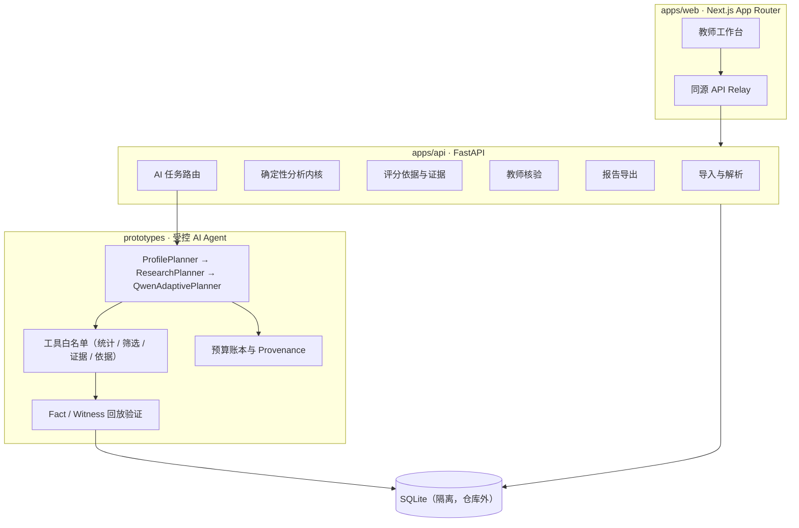
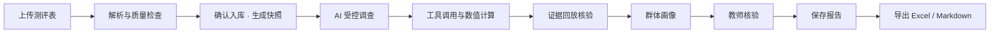

<div align="center">

# 未然 EDU · WEIRAN EDU

**面向高校编程测评的 AI 能力画像与可信分析平台。**

让测评分数不再是孤立的数字，而是可核验、可追溯、可解释的能力证据。

<p>
  
  
  
  
  
</p>

**数据导入 · 五维画像 · 群体发现 · AI 调查 · 证据核验 · 报告导出**

</div>

---

## 产品定位

未然 EDU 面向高校程序设计类课程的测评场景，把一次批改后的 Excel 评分表转化为结构化的能力画像与教学洞察。区别于「只给平均分」的统计工具，它强调**每一个结论都能回到原始评分依据**：AI 只负责提出值得核查的方向，所有数值与证据都由确定性的分析内核计算与回放验证。

## 界面展示

<!-- TODO: 产品界面截图（由设计负责人提供后替换此占位，放置于 assets/ 下） -->

## 核心能力

- **测评数据导入与校验**：按固定模板解析 Excel，进行质量检查与预览，确认后入库，保留文件哈希与快照版本。
- **五维能力画像**：算法与数据结构、代码实现能力、问题建模能力、效率意识、解题策略五个维度的有效评分统计、均值与分布。
- **群体差异发现**：多维条件组合筛选，自动发现群体间评分差异与值得核查的组合。
- **AI 受控调查**：受控 Agent 在工具白名单内自主选择调查方向，提出「值得优先核查」的问题，而非直接生成结论。
- **评分依据核验**：每个统计事实都能下钻到逐条评分证据与原始单元格定位，支持教师确认或否决。
- **报告生成与导出**：教师核验后生成分析报告，导出 Excel / Markdown。

## 技术架构



## 系统工作流程



## 技术亮点

- **确定性分析内核**：评分统计与群体比较使用精确有理数（`Fraction`）计算，避免浮点误差；AI 不参与数值计算，只做方向选择。
- **来源可回放**：每个事实（Fact）与证据（Witness）都绑定快照与来源摘要，读取时重新计算并与持久化结果比对，防止「结果被篡改」。
- **受控 AI Agent**：模型只在固定工具 schema 内调用（维度统计、群体筛选、证据读取、评分依据），每条调用前后都重新校验授权与预算。
- **披露隐私保护**：聚合统计遵循最小样本数（minimum-cell）阈值，低于阈值不下钻到个体，避免通过筛选反推个体成绩。
- **可信执行来源**：离线演示与真实模型请求通过 `provenance`（`http_mock` / `qwen_live`）严格区分，预算账本单次消费、不可重复领取。

## 快速开始

### 本机演示（推荐）

一条命令启动隔离 SQLite 与合成演示数据，无需任何密钥、不发付费请求：

```powershell
# 首次安装与构建
cd apps/web && corepack pnpm install --frozen-lockfile && corepack pnpm build
cd ../..\apps\api && uv sync --locked --group dev
cd ../..

# 启动（Identity=first：空数据教师走完整首用流程；Identity=sample：预置样例批次）
powershell -NoProfile -ExecutionPolicy Bypass -File scripts\local\start-demo.ps1 -Identity first -Port 3000
```

打开 http://127.0.0.1:3000/ 进入教师工作台。

### 分别运行前后端

前端（Next.js）：

```powershell
cd apps/web
corepack pnpm install --frozen-lockfile
corepack pnpm dev
```

后端（FastAPI）：

```powershell
cd apps/api
uv sync --locked --group dev
uv run --locked uvicorn app.main:create_app --factory --host 127.0.0.1 --port 8000 --reload
```

接口文档：http://127.0.0.1:8000/docs

## 项目结构

```text
apps/web/             Next.js 教师工作台与前端工具链
apps/api/             FastAPI、SQLite、统计分析、AI 服务与测试
prototypes/           受控 AI Agent 与任务编排原型
evals/                评测与验证证据
docs/                 架构、接口契约与技术设计
scripts/local/        本机启动 / 停止脚本
.github/workflows/    CI
```

## 技术栈

| 层 | 技术 |
| --- | --- |
| 前端 | Next.js 16.4、React 19、TypeScript 5.9、Ant Design 6、ECharts 6 |
| 后端 | Python 3.12、FastAPI、Pydantic、Uvicorn、SQLite |
| AI | 受控 Function Calling Agent、原生对话协议、预算账本与执行来源追踪 |
| 质量 | ESLint、Prettier、Ruff、pytest、浏览器端到端测试 |

## 开发规范与团队

提交、测试与评审约定见 [AGENTS.md](AGENTS.md)。

| 成员 | 分工 |
| --- | --- |
| ZAMYL | 负责人，分析规则与 AI 模块 |
| AooMing（林明） | 前端 `apps/web/` |
| Peng-Kai789（彭仲楷） | 后端 `apps/api/` |

## 数据与隐私

本仓库不含真实学生数据、评分文件、密钥或数据库。开发与测试使用经审查的合成内容；真实数据文件一律保存在仓库外，并遵循 [.gitignore](.gitignore) 的忽略规则。
