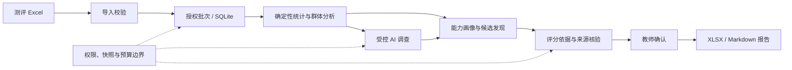

<div align="center">
  <h1>未然 EDU · WEIRAN EDU</h1>
  <p><strong>让高校编程测评，从分数统计走向可核验的能力洞察。</strong></p>
  <p>面向高校编程教学与程序设计竞赛的 AI 辅助测评分析平台</p>
  <p>
    
    
    
    
  </p>
  <p><strong>数据导入 · 五维画像 · 群体差异 · AI 调查 · 评分依据 · 报告导出</strong></p>
  <p>
    <a href="#-快速体验">快速体验</a> ·
    <a href="#-核心能力">核心能力</a> ·
    <a href="#-技术架构">技术架构</a> ·
    <a href="docs/competition/README.md">比赛展示</a>
  </p>
</div>

---

## ✨ 为什么做未然 EDU？

高校编程竞赛与课程测评会产生大量答题评价数据。只有均分、排名和表格，往往不足以回答：

- **能力差异在哪里？** 不同选手的算法、实现、建模、效率与策略表现如何？
- **哪些群体值得关注？** 差异涉及多少人、统计口径是什么？
- **结论能不能核对？** 分析发现是否能回到原评分与评分依据？

**未然 EDU 将结构化分析、受控 AI 调查与教师核验串成一条工作流。** 平台辅助发现值得关注的现象，最终解释与使用仍由教师判断。

## 🎬 产品体验

> **传智杯 V1.3.1 展示候选版**：真实 HTTP、Next.js、FastAPI 与 SQLite 可以在本地运行；已有浏览器端到端测试覆盖“导入 → 分析 → 核验 → 导出”。演示录屏正在整理，完成隐私审查后在 [比赛展示页](docs/competition/README.md) 更新。

| 01 · 上传测评 | 02 · 发现差异 | 03 · 核对依据 | 04 · 输出报告 |
|:--|:--|:--|:--|
| 读取固定模板 XLSX，检查完整性并确认导入 | 五维评分、统计分布、群体比较与画像 | 查看实际评分指标、参与人数与来源记录 | 教师确认分析结果，导出 XLSX / Markdown |

**演示数据说明：** 比赛演示可使用经授权、已脱敏的真实竞赛评价数据。原始答题卡、个人身份信息、实际 Excel、数据库和密钥均不随仓库公开。

## 🧠 核心能力

| 能力 | 实际用途 | 技术重点 |
|:--|:--|:--|
| **结构化数据导入** | 上传评分工作簿，识别错误和提醒，确认后生成测评批次 | 模板校验、定点评分、不可变来源 |
| **多维能力画像** | 观察五维评分结构、分布与群体差异 | 确定性统计、完整样本口径 |
| **AI 辅助调查** | 围绕评分问题组织工具查询与结果解释 | 受控 Agent 编排、工具预算与状态 |
| **可核验的分析发现** | 追溯人数、数值、评分维度及证据来源 | 来源绑定、回放核验、权限隔离 |
| **教师确认与报告** | 核验、保存、导出可复用的测评结论 | 版本化结果、XLSX / Markdown |

## 🏗️ 技术架构



- **前端**：Next.js App Router、React、TypeScript、Ant Design、ECharts
- **服务端**：Python、FastAPI、Pydantic、SQLite、SQL 迁移
- **分析与 AI**：确定性评分计算、群体洞察、受控 Agent、Qwen 接口适配与离线执行测试
- **质量验证**：pytest、Ruff、TypeScript、前端单测、真实浏览器端到端测试

**模型执行边界：** 当前公开可复现的本地演示链路标记为 `http_mock`，**不能当作真实 Qwen API 已完成调用的证明**。真实 Qwen 路径仍需独立审批、费用控制与正式路由验收。详情见 [AI 接入说明](docs/QWEN_V131_BACKEND_WIRING.md)。

## 🚀 快速体验

在 **Windows** 上，从仓库根目录启动本机隔离演示环境（首次安装 Node.js 24、Python 3.12、uv 与项目依赖，见 [完整启动指南](scripts/local/README.md)）：

```powershell
# 空数据工作台：体验首次上传流程
powershell -NoProfile -ExecutionPolicy Bypass -File scripts\local\start-demo.ps1 -Identity first

# 或：打开已有合成样例批次
powershell -NoProfile -ExecutionPolicy Bypass -File scripts\local\start-demo.ps1 -Identity sample
```

默认访问 `http://127.0.0.1:3000/insights`。本机演示使用隔离 SQLite 和已登记的合成测试来源，不发送付费模型请求；**不要直接把真实评分文件提交进仓库或当作公开测试夹具**。

需要在正式教师数据来源中导入工作簿时，请遵循 [数据库及权限说明](docs/DATABASE_BATCH_AUTH.md) 与 [Excel 模板说明](docs/EXCEL_PARSER.md)。

## 📚 代码与文档导航

| 路径 | 内容 |
|:--|:--|
| [`apps/web/`](apps/web/) | 教师工作台、交互、数据可视化 |
| [`apps/api/`](apps/api/) | FastAPI、数据库、统计分析与 AI 服务 |
| [`prototypes/`](prototypes/) | 受控 Agent 与任务编排原型 |
| [`evals/`](evals/) | 测试与评估证据 |
| [`docs/competition/`](docs/competition/README.md) | 比赛展示、演示材料与技术证据 |
| [`docs/`](docs/) | 完整工程契约和历史技术记录 |
| [`AGENTS.md`](AGENTS.md) | 协作规范与质量门槛 |

历史设计文档保留用于追溯，**不代表当前运行时 API**；以仓库代码、OpenAPI 和实际验收结果为准。

## 👥 团队

| 成员 | 职责 |
|:--|:--|
| **ZAMYL** | 项目统筹、AI Agent、分析规则、技术方案 |
| **AooMing · 林明** | 前端工作台、交互设计、产品演示 |
| **Peng-Kai789 · 彭仲楷** | FastAPI、数据库、API、测试与联调 |

---

<div align="center">
  <strong>未然 EDU · 让真实数据产生价值，让分析结论有据可查。</strong>
  <p>面向教学研究与竞赛展示的持续迭代项目 · 未经验证的功能不作为正式交付承诺</p>
</div>
