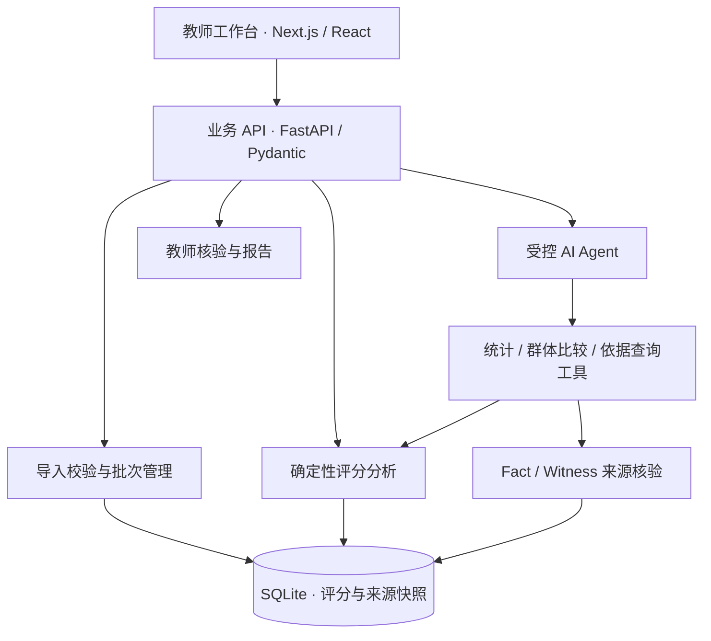

<div align="center">

# 未然 EDU · WEIRAN EDU

### AI 时代的编程能力与学习成效诊断平台

**让教师看见编程表现背后的能力差异。**

<p>从编程测评资料中发现能力结构、追溯评分依据，辅助教师做出更有针对性的教学判断。</p>

<p>
  
  
  
  
  
</p>

**测评资料理解 · 编程能力画像 · 群体差异 · AI 学情调查 · 可信核验 · 教学报告**

[认识产品](#认识未然-edu) · [核心能力](#核心能力) · [技术设计](#技术设计) · [快速开始](#快速开始)

</div>

---

## 认识未然 EDU

编程教学留下的证据，远不止一张成绩表。竞赛答题卡、课程作业、程序设计实践及教师评分记录，常常记录着学生面对问题时不同的能力表现。教师真正关心的是：有些学生思路清晰，为什么实现环节仍有差距？一项共同的薄弱能力涉及多少人？这些判断究竟来自什么证据？

**未然 EDU（WEIRAN EDU）是面向这些问题构建的编程能力与学习成效诊断平台。** 我们希望把已有的测评资料转化为可理解的能力画像、值得追问的群体发现，以及能够回到评分依据的教学分析，让教师不仅看见“多少分”，还能看见表现背后的能力差异。

它不是把 Excel 换一种方式排版，也不是直接让模型写一段笼统的学生评价。**数据分析负责准确计算，AI Agent 负责组织调查与工具查询，教师负责核查证据并决定如何使用结论。** 这样的分工，让分析能够经得起追问，也更有机会真正进入教学工作。

产品面向编程课程、实践训练与程序设计竞赛等多种场景。当前已经落地的是结构化评分资料的导入与分析流程；**V1.4 的目标是把原始答题卡（ZIP/HTML）以及代码、测试点证据纳入同一条链路**，并让真实 Qwen 调查在网页上完成。

## 核心能力

| 能力 | 对教师意味着什么 |
| --- | --- |
| **资料接入与质量检查** | 单文件、多文件与 ZIP 统一入口，自动识别文件角色与字段含义（V1.4 目标；当前可用的是固定双 Sheet 适配器） |
| **编程能力画像** | 从算法与数据结构、代码实现、问题建模、效率意识、解题策略五个维度观察能力表现及差异 |
| **典型错误模式** | 按题目与群体汇总错误现象、可定位的代码特征及可能的知识薄弱点 |
| **群体差异与探索** | 不只看整体均分，还能比较符合不同条件的群体，查看人数、分值和分布 |
| **真实 AI Agent 调查** | 服务端真实请求 Qwen，由模型调用本地分析工具，形成值得继续核查的分析线索 |
| **评分依据与事实核验** | 从结论回到参与记录、具体代码、测试记录和评分依据，减少“结论说得好却无法查证”的问题 |
| **教学核查与报告** | 教师确认有效发现后保存、导出分析结果，用于竞赛复盘、课程评价与教学讨论 |

### 从测评资料到教学判断


平台使用**测评批次**组织数据，而不是假设每一批记录都来自同一个班级。一场程序设计竞赛可以包含不同班级甚至不同学校的选手；分析按实际有效记录和数据来源展开。

## 应用场景与真实案例

编程竞赛复盘需要的不只有排名：选手在建模、算法、实现和策略上的表现可能并不一致。课程实践评价也有类似需求——教师想了解哪些能力差异更普遍，哪些需要进一步查看具体评分依据。

作为实际数据案例，我们使用 **2025 年某高校程序设计竞赛的匿名评价数据**开展分析：105 名参赛者、五个评价维度、525 条评分记录。其中“解题策略”平均得分约 **4.13**，“效率意识”约 **3.01**。这提示我们可以进一步核查：哪些选手群体同时表现出较好的解题策略与相对薄弱的效率意识？涉及多少人？哪些评分记录支持这一观察？

这只是平台应用场景中的一个切面。**未然 EDU 关注的不是某一份表格，而是从编程表现中发现、解释并核验能力差异的方法。** 本仓库不包含原始答题卡、个人身份或真实评分文件。

## 技术设计

项目采用 Next.js + FastAPI 的 Web 架构，把界面交互、确定性统计、Agent 调查和证据查询分成职责清楚的模块。



**为什么不让大模型直接算分数？** 评分、分布和群体比较需要精确且可复核，因此由确定性程序完成；模型负责分析方向和工具选择。项目对评分使用定点数据与有理数计算，减少浮点误差。

**为什么要把证据链做到系统里？** 分析结果与批次快照、评分维度、参与记录和来源凭据关联。查询结果不仅可以显示，还可以回到相应依据复核。

**为什么 Agent 需要约束？** 一次调查有模型请求、工具尝试、授权和数据披露边界。系统通过工具白名单、共享预算、权限校验与来源回放控制执行过程，而不是依赖提示词要求模型“务必准确”。

**为什么重视测试？** 除了正常操作，项目也关注空结果、缺失评分、不同人数、权限撤销、预算耗尽、来源不一致和恢复重试等情况；用自动化测试检查从数据到结论的完整性。

模型侧设计包含兼容千问 API 的受控适配机制，具体调用与权限由对应运行环境配置管理。**V1.4 要求这条链路真正接通**：服务端发出真实请求、模型调用本地分析工具，浏览器能看到同一批次的调查结果。技术细节和验证记录保留在项目文档中。

## 快速开始

环境依赖：Node.js 24、Python 3.12、[uv](https://docs.astral.sh/uv/)、Corepack / pnpm。建议在 Windows PowerShell 中运行以下命令。

### 安装依赖

```powershell
# 仓库根目录
cd apps/web
corepack pnpm install --frozen-lockfile
corepack pnpm build

cd ../api
uv sync --locked --group dev

cd ../..
```

### 启动教师工作台

```powershell
# 首次使用流程：从空测评进入上传
powershell -NoProfile -ExecutionPolicy Bypass -File scripts\local\start-demo.ps1 -Identity first -Port 3000

# 或查看已有样例批次
powershell -NoProfile -ExecutionPolicy Bypass -File scripts\local\start-demo.ps1 -Identity sample -Port 3000
```

打开 **http://127.0.0.1:3000/**。本机脚本会启动隔离的 Web、API 和 SQLite 测试实例，不需要个人模型密钥。正式教师资料的导入与访问应配置对应的服务端数据来源和授权。

详细运行方式请见 [本地启动说明](scripts/local/README.md)、[Excel 解析规则](docs/EXCEL_PARSER.md)及[数据库与权限](docs/DATABASE_BATCH_AUTH.md)。

## 项目结构

```text
apps/web/             Next.js 教师工作台与数据可视化
apps/api/             FastAPI、评分分析、数据库与接口
prototypes/           Agent 调查与相关技术原型
evals/                评测与回归验证
docs/                 技术设计、接口契约及工程记录
scripts/local/        本地环境启动与停止
.github/workflows/    自动化检查
```

## 团队

| 成员 | 主要负责 |
| --- | --- |
| **ZAMYL（佘俊泽）** | 项目负责、产品规划、AI Agent 核心、分析规则与评测、最终验收 |
| **AooMing（林明）** | 教师工作台、前端体验与交互设计、浏览器端到端验收 |
| **Peng-Kai789（彭仲楷）** | FastAPI、数据库、业务 API、通用资料接入与真实 AI 任务后端接线 |

需求口径见 [PRD](docs/PRD.md)（V1.4 基线），工程协作与质量要求见 [AGENTS.md](AGENTS.md)。

---

<div align="center">

**让教师看见编程表现背后的能力差异。**

<sub>未然 EDU · AI 时代的编程能力与学习成效诊断平台</sub>

</div>
