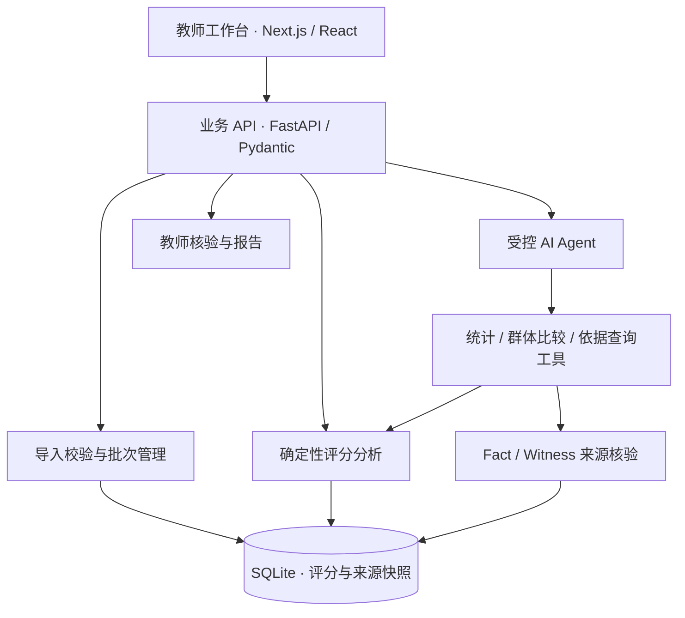

<div align="center">

# 未然 EDU · WEIRAN EDU

### AI 时代的编程能力与学习成效诊断平台

**让教师看见编程表现背后的能力差异。**

<p>让每一份测评数据，都成为有依据的教学洞察。</p>

<p>
  
  
  
  
  
</p>

**测评导入 · 能力画像 · 群体差异 · AI 学情调查 · 证据核验 · 教师报告**

[认识产品](#认识未然-edu) · [核心能力](#核心能力) · [技术设计](#技术设计) · [快速开始](#快速开始)

</div>

---

## 认识未然 EDU

当教师拿到一批编程竞赛或课程实践的评价结果，最容易看到的是分数和排名。可是，分数往往不能直接回答另一些更有价值的问题：哪些学生擅长算法思路，却在实现效率上存在不足？不同能力组合分别涉及多少人？这些判断又来自哪些实际记录？

未然 EDU 从这样的教学场景出发，尝试把分散在测评资料中的数据组织成**能理解、可追问、可复核**的学习成效信息。

我们希望它不只是一张更漂亮的统计报表，也不只是把 Excel 交给聊天机器人生成一段评价。**结构化计算负责回答“数据是什么”，AI 辅助调查负责寻找值得探究的方向，教师则始终保有核查和判断的主动权。**

长期方向涵盖编程课程测评、实践训练与程序设计竞赛等多种学习证据；目前的可运行流程以受支持的结构化评分资料为入口，持续向更丰富的数据接入和更细粒度的能力分析发展。

## 核心能力

| 能力 | 对教师意味着什么 |
| --- | --- |
| **测评资料导入与检查** | 上传符合格式的 Excel，查看结构、评分范围及异常提示，确认后形成可追溯的测评批次 |
| **五维编程能力画像** | 从算法与数据结构、代码实现、问题建模、效率意识、解题策略五个维度理解评分结构 |
| **群体差异与探索** | 不只看整体均分，还能比较符合不同条件的群体，查看人数、分值和分布 |
| **AI 辅助学情调查** | 围绕教师关心的评分问题组织受控工具查询，形成可以进一步核查的分析线索 |
| **评分依据与事实核验** | 从结论回到参与记录、具体评分和来源依据，减少“结论说得好却无法查证”的问题 |
| **教师确认与报告输出** | 将有依据的发现保存为分析结果，导出 Excel 或 Markdown，用于复盘与教学讨论 |

### 从资料到教学行动


平台使用**测评批次**组织数据，而不是假设每一批记录都来自同一个班级。一场程序设计竞赛可以包含不同班级甚至不同学校的选手；分析按实际有效记录和数据来源展开。

## 一份真实数据，能看到什么

我们使用过一份 **2025 年高校程序设计竞赛的匿名评价数据**开展产品展示：105 名参赛者、五个评分维度、525 条评分记录。

其中，“解题策略”的平均得分约为 **4.13**，“效率意识”约为 **3.01**。这组差异并不足以判断学生的个性或能力成因，却能启发一个有价值的追问：哪些群体呈现“策略较好、效率意识偏弱”的组合？涉及多少人？具体依据是什么？

**未然 EDU 希望让这样的追问从直觉变成可以核验的数据探索。** 展示数据已匿名化；原始答题卡、真实评分文件和个人身份信息不纳入本仓库。

## 技术设计

项目采用 Next.js + FastAPI 的 Web 架构，把界面交互、确定性统计、Agent 调查和证据查询分成职责清楚的模块。



**为什么不让大模型直接算分数？** 评分、分布和群体比较需要精确且可复核，因此由确定性程序完成；模型负责分析方向和工具选择。项目对评分使用定点数据与有理数计算，减少浮点误差。

**为什么要把证据链做到系统里？** 分析结果与批次快照、评分维度、参与记录和来源凭据关联。查询结果不仅可以显示，还可以回到相应依据复核。

**为什么 Agent 需要约束？** 一次调查有模型请求、工具尝试、授权和数据披露边界。系统通过工具白名单、共享预算、权限校验与来源回放控制执行过程，而不是依赖提示词要求模型“务必准确”。

**为什么重视测试？** 除了正常操作，项目也关注空结果、缺失评分、不同人数、权限撤销、预算耗尽、来源不一致和恢复重试等情况；用自动化测试检查从数据到结论的完整性。

模型侧设计包含兼容千问 API 的受控适配机制，具体调用与权限由对应运行环境配置管理。技术细节和验证记录保留在项目文档中。

## 快速开始

环境依赖：Node.js 24、Python 3.12、[uv](https://docs.astral.sh/uv/)、Corepack / pnpm。建议在 Windows PowerShell 中运行以下命令。

### 安装依赖

```powershell
# 仓库根目录
cd apps/web
corepack pnpm install --frozen-lockfile
corepack pnpm build

cd ../api
uv sync --locked --group dev

cd ../..
```

### 启动教师工作台

```powershell
# 首次使用流程：从空测评进入上传
powershell -NoProfile -ExecutionPolicy Bypass -File scripts\local\start-demo.ps1 -Identity first -Port 3000

# 或查看已有样例批次
powershell -NoProfile -ExecutionPolicy Bypass -File scripts\local\start-demo.ps1 -Identity sample -Port 3000
```

打开 **http://127.0.0.1:3000/**。本机脚本会启动隔离的 Web、API 和 SQLite 测试实例，不需要个人模型密钥。正式教师资料的导入与访问应配置对应的服务端数据来源和授权。

详细运行方式请见 [本地启动说明](scripts/local/README.md)、[Excel 解析规则](docs/EXCEL_PARSER.md)及[数据库与权限](docs/DATABASE_BATCH_AUTH.md)。

## 项目结构

```text
apps/web/             Next.js 教师工作台与数据可视化
apps/api/             FastAPI、评分分析、数据库与接口
prototypes/           Agent 调查与相关技术原型
evals/                评测与回归验证
docs/                 技术设计、接口契约及工程记录
scripts/local/        本地环境启动与停止
.github/workflows/    自动化检查
```

## 团队

| 成员 | 主要负责 |
| --- | --- |
| **ZAMYL** | 产品规划、编程能力分析、AI Agent 与技术方案 |
| **AooMing · 林明** | 教师工作台、前端体验与交互设计 |
| **Peng-Kai789 · 彭仲楷** | FastAPI、数据库、业务 API 与联调测试 |

工程协作与质量要求见 [AGENTS.md](AGENTS.md)。

---

<div align="center">

**让教师看见编程表现背后的能力差异。**

<sub>未然 EDU · AI 时代的编程能力与学习成效诊断平台</sub>

</div>
