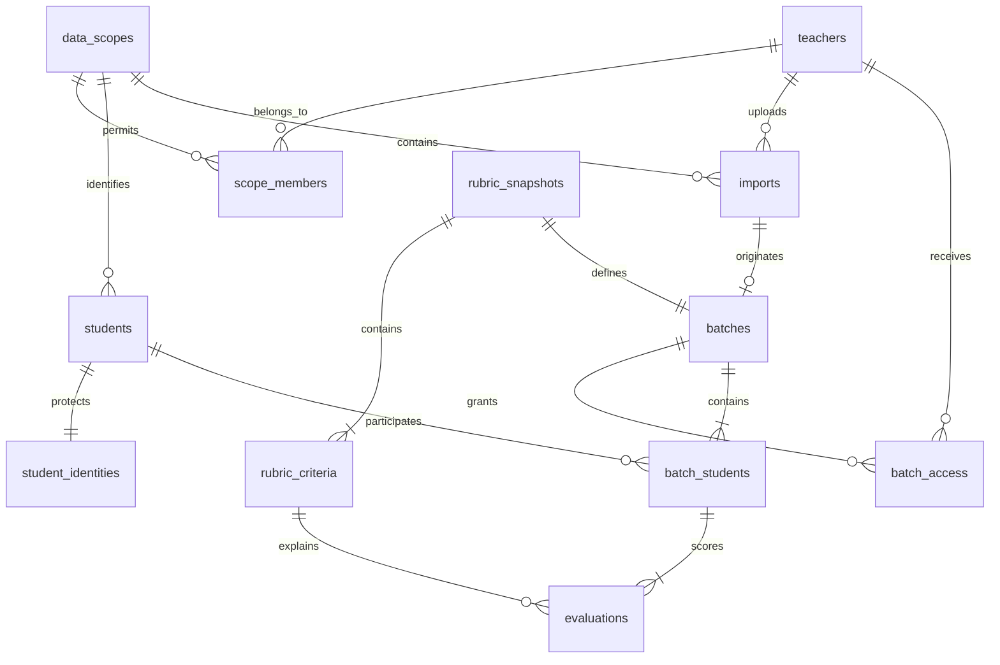

# 未然 EDU 数据结构草案 v0.1

日期：2026-10-23。状态：数据库与 DTO 设计草案，无迁移、ORM、真实数据库或业务代码。

依据：[后端冻结规则](BACKEND_CONTRACT_V0.1.md)；对外 DTO 以 [API 草案](API_CONTRACT_V0.1.md) 和 [OpenAPI](contracts/edu-api.v0.1.openapi.json) 为准。下列为建议物理模型，实施前与相关负责人对齐，不擅自宣称全部字段已经冻结。

## 1. 关系与存储约定

图中 `imports → batches` 表示原始创建关系：一个正式批次只有一个来源导入；重复上传的其他导入可指向同一已确认批次，不重新创建正式来源。

- 独立 SQLite 数据库、原始上传和暂存对象位于仓库外受控目录，由服务端配置路径；API 从不返回该路径。
- ID 建议采用随机 UUID 派生的不透明字符串。学生内部主键与对外匿名 ID 分离，其余 ID 也不能编码身份。
- 时间使用 UTC 文本；日期允许为空。版本标识不可变，哈希使用小写 64 位 SHA-256 十六进制。
- 评分使用 `score_units INTEGER`，表示百分之一分：API 的 `2.5` 对应 `250`。限制为整数 100～500，不以 SQLite REAL 保存原始分数。
- `TEXT?` 表示可空；未注明可空的业务字段均为非空。JSON 文本必须经过服务端验证，不将其作为可执行表达式。
- 每个数据库连接显式启用 `PRAGMA foreign_keys=ON`。SQLite 的类型亲和性不能代替校验，应使用整数类型检查、CHECK、UNIQUE 和复合外键。
- 默认禁止级联删除原始批次及证据；首版没有删除 API。保留期限与删除流程未定之前，不伪称永久保存或已实现删除。

## 2. 权限与来源范围

### teachers

| 字段 | 类型 | 约束 / 用途 |
| --- | --- | --- |
| `teacher_id` | TEXT PK | 教师内部 ID |
| `auth_issuer` | TEXT | 受信认证发行方 |
| `auth_subject` | TEXT | 发行方内的稳定主体，不接受客户端自报 |
| `is_active` | INTEGER | CHECK IN (0,1) |
| `created_at` | TEXT | 创建时间 |

UNIQUE `(auth_issuer, auth_subject)`。本表仅映射已验证身份，不保存密码、明文访问令牌或自行实现认证体系。不能跨发行方按 subject 合并；最终接入方式待确认。

### data_scopes / scope_members

| 表 | 主要字段 | 约束 |
| --- | --- | --- |
| `data_scopes` | `data_scope_id TEXT PK`、`label TEXT`、`created_at TEXT` | 试点或学校来源命名空间，不是完整全校多租户系统 |
| `scope_members` | `data_scope_id TEXT FK`、`teacher_id TEXT FK`、`can_import INTEGER` | 联合 PK；`can_import` 仅 0/1 |

拥有来源范围成员资格不自动拥有所有批次读取权。创建来源和发放权限由受控配置或管理流程完成，本次没有开放权限管理 API。

### batch_access

字段：`batch_id TEXT FK`、`teacher_id TEXT FK`、`permission TEXT CHECK IN ('read')`、`granted_at TEXT`。联合 PK `(batch_id, teacher_id)`。

批次拥有者隐式拥有读取和修订权，额外授权当前只开放读取。读取条件为“活跃教师＋有效来源成员资格＋（批次拥有者或显式读授权）”。修订还要求拥有者及 `can_import=1`。授予他人读取权限的操作不在本次 API 内，默认没有共享授权。

## 3. 学生与真实身份映射

### students

| 字段 | 类型 | 约束 / 用途 |
| --- | --- | --- |
| `student_pk` | TEXT PK | 仅服务端内部使用 |
| `public_id` | TEXT UNIQUE | API 的 `student_id`，随机且稳定 |
| `data_scope_id` | TEXT FK | 身份所属来源范围 |
| `created_at` | TEXT | 首次正式入库时间 |

增加 UNIQUE `(student_pk, data_scope_id)`，供复合外键保证跨表范围一致。

### student_identities（受控表）

| 字段 | 类型 | 约束 / 用途 |
| --- | --- | --- |
| `student_pk` | TEXT PK/FK | 与学生一对一 |
| `data_scope_id` | TEXT FK | 必须与 students 一致 |
| `student_number` | TEXT | 保留学号字符串，模板要求 12 位数字 |
| `student_name` | TEXT | 仅核对，不是唯一键 |
| `created_at` | TEXT | 身份映射创建时间 |

UNIQUE `(data_scope_id, student_number)`，复合 FK `(student_pk, data_scope_id) → students`。身份匹配按此唯一键执行，不能按姓名匹配。再次导入同学号但姓名不同，不静默修改已有身份，回到预览给出需人工核对的阻止入库问题。

原始学生信息单元格不放入公开学生表，而与本次评分来源一起保存在受控原始记录中。普通查询按白名单投影，禁止 `SELECT *` 直接序列化。受控表拆分本身不等于加密；文件访问控制、密钥、备份与加密实现仍须设计。

## 4. 导入暂存

### imports

| 字段 | 类型 | 约束 / 用途 |
| --- | --- | --- |
| `import_id` | TEXT PK | 预览和确认资源 ID |
| `owner_teacher_id` | TEXT FK | 上传教师，不能由表单指定 |
| `data_scope_id` | TEXT FK | 已核验的来源范围 |
| `status` | TEXT | `preview_ready / invalid / committed / expired` |
| `title`、`course`、`assessment_date` | TEXT、TEXT?、TEXT? | 随预览绑定，确认时不能替换 |
| `revision_of_batch_id` | TEXT? FK | 可空修订目标 |
| `file_sha256` | TEXT | 上传字节摘要 |
| `content_sha256` | TEXT? | 成功完成规范化时才有，不给损坏输入编造摘要 |
| `content_hash_version` | TEXT | 摘要规范版本 |
| `parser_version` | TEXT | 固定模板适配器版本 |
| `rubric_version` | TEXT? | 有效标准内容版本，缺失标准时为空 |
| `preview_version` | TEXT | 暂存内容与元数据的绑定摘要 |
| `created_at`、`expires_at` | TEXT | 24 小时有效期 |
| `summary_json` | TEXT | 非敏感的解析计数 |
| `staging_object_key` | TEXT? | 仓库外受控暂存对象引用，不对外返回 |
| `committed_batch_id` | TEXT? FK | 已创建或重复命中的正式批次 |

暂存对象包含原始文件引用、解析后的原值、身份、预览匿名 ID、来源和完整质量问题；它不是公开 JSON 文件。尚未确认时不写 `students`、`student_identities`、`batch_students` 或 `evaluations`。仅可读取的预览样本与问题在服务端脱敏并分页。

`committed` 必须有 `committed_batch_id`；其他状态必须没有该关联。`invalid` 必须有阻止入库错误；`preview_ready` 必须至少有一名完整学生且无阻止错误。已提交记录保留非敏感幂等关联和摘要，个人暂存材料按后续保留策略清理。确认后不能再把 `committed` 改成 `expired`。

同范围不同预览允许具有相同哈希；不能在 imports 上设哈希 UNIQUE，否则会把“重复上传预览”与“重复正式测评”混为一谈。

索引建议：`(owner_teacher_id, created_at)`、`(status, expires_at)`。是否存分表质量问题留给后续性能需要；当前数据量先以受控暂存对象保存。

## 5. 标准快照与测评批次

### rubric_snapshots / rubric_criteria

| 表 | 字段与约束 |
| --- | --- |
| `rubric_snapshots` | `rubric_id TEXT PK`、`rubric_version TEXT`、`created_at TEXT` |
| `rubric_criteria` | `rubric_criterion_id TEXT PK`、`rubric_id TEXT FK`、`dimension_code TEXT`、`display_name TEXT`、`original_name TEXT`、`criteria_text_raw TEXT`、`file_sha256 TEXT`、`sheet_name TEXT`、`source_range TEXT` |

每个正式批次拥有自己的不可变标准快照，`rubric_version` 为标准内容版本；版本值允许在不同快照中相同，不能因标准相同就把不同文件的来源覆盖成一次来源。UNIQUE `(rubric_id, dimension_code)`，维度 CHECK 为冻结的五个编码，确认事务核对恰好五项。

标准正文在公开读取前也检查身份信息；未完成必要检查时不回传未经处理内容。来源区域保留实际合并范围，不只记锚点。

### batches

| 字段 | 类型 | 约束 / 用途 |
| --- | --- | --- |
| `batch_id` | TEXT PK | 正式批次 ID |
| `data_scope_id` | TEXT FK | 来源范围 |
| `owner_teacher_id` | TEXT FK | 创建教师 |
| `source_import_id` | TEXT UNIQUE FK | 唯一原始创建导入，不因重复上传替换 |
| `title`、`course`、`assessment_date` | TEXT、TEXT?、TEXT? | 不虚构未知信息 |
| `rubric_id` | TEXT UNIQUE FK | 本批独立标准快照 |
| `file_sha256`、`content_sha256` | TEXT | 文件与规范化内容摘要 |
| `content_hash_version`、`parser_version` | TEXT | 规范化和解析版本 |
| `revision_of_batch_id` | TEXT? FK | 同范围旧批次，不能指向自身 |
| `student_count`、`evaluation_count` | INTEGER | 正整数，来自正式写入后核对 |
| `created_at` | TEXT | 入库时间 |

数据库约束：

- UNIQUE `(data_scope_id, file_sha256)`；UNIQUE `(data_scope_id, content_hash_version, content_sha256)`，防止并发重复正式测评。
- UNIQUE `(batch_id, data_scope_id)` 和 `(batch_id, rubric_id)`，用于复合外键。
- `revision_of_batch_id IS NOT NULL` 时 UNIQUE，禁止同一个旧版本出现两个直接后继；CHECK 与本批 ID 不同，复合 FK 保证同范围。确认事务还检查链末端与拥有者权限。
- CHECK `evaluation_count = student_count * 5`；该检查只约束缓存计数，不能代替服务层对实际行数及维度的核对。
- `is_current` 不单独持久化，由是否存在后继批次计算；旧数据、旧标准和旧证据不更新。

导入与批次互相引用时，在各自的 CREATE TABLE 语句中完整声明外键，建立全部表后才开始业务写入；不依赖 SQLite 不支持的 ALTER TABLE ADD CONSTRAINT。确认前 imports 记录已存在，且 committed_batch_id 为空；事务中先插入引用该导入的批次，最后更新 imports 的提交关联，因此不需要为此关闭外键或拆成多个非原子事务。

索引建议：`(owner_teacher_id, created_at, batch_id)`、`(data_scope_id, created_at, batch_id)`，以及明确的修订关联索引。

## 6. 学生五维评分、评语与证据

### batch_students

字段：`batch_id TEXT FK`、`student_pk TEXT FK`、`data_scope_id TEXT FK`、`display_label TEXT`、`display_order INTEGER`。

- 联合 PK `(batch_id, student_pk)`。
- 复合 FK `(batch_id, data_scope_id) → batches`，`(student_pk, data_scope_id) → students`，阻止把其他范围学生挂到本批。
- 批内 `display_order` 与 `display_label` 分别唯一；匿名编号不是分数排名，也不能由学号截取产生。

### evaluations

一行代表“一个批次、一个学生、一个维度”的一次评分及评语，**该行本身就是稳定的评分证据**，无需额外建立内容重复的证据表。

| 字段 | 类型 | 约束 / 用途 |
| --- | --- | --- |
| `evidence_id` | TEXT PK | API 和洞察引用的稳定证据 ID |
| `batch_id`、`student_pk` | TEXT | 联合 FK 到 batch_students |
| `rubric_id`、`dimension_code` | TEXT | 指向本批标准中的对应维度 |
| `score_units` | INTEGER | CHECK 整数且 100～500 |
| `score_raw` | TEXT | 原始单个评分文本，不覆盖 |
| `comment_raw` | TEXT | 原始评语；允许空串，不允许用 null 表示丢失 |
| `comment_display` | TEXT? | 已检查、可返回的展示文本 |
| `comment_status` | TEXT | `screened / masked / empty / withheld` |
| `redaction_version` | TEXT? | 完成检查时记录所用策略版本 |
| `identity_cell_raw` | TEXT | 本条来源块的原始身份单元格，仅受控保存 |
| `file_sha256`、`sheet_name` | TEXT | 文件与工作表来源 |
| `source_row` | INTEGER | 一基行号，CHECK > 0 |
| `dimension_cell`、`score_cell`、`comment_cell` | TEXT | 原始坐标，不是磁盘路径 |
| `created_at` | TEXT | 证据创建时间 |

约束：UNIQUE `(batch_id, student_pk, dimension_code)`；复合 FK `(batch_id, rubric_id) → batches`、`(rubric_id, dimension_code) → rubric_criteria`，防止评分借用其他批次标准。`screened/masked` 必须有非空 `comment_display` 和 `redaction_version`；`empty/withheld` 的展示文本必须为空。原始评语始终保留，屏蔽状态不应把原文清空。

`comment_raw`、`identity_cell_raw` 属于受控列，普通 DTO 不存在这两个字段。对外来源的文件哈希需与所属批次的原始来源一致，提交前核对，不能接收客户端提供的坐标、证据 ID 或哈希作为事实。

索引建议：`(batch_id, dimension_code, score_units, student_pk)` 支持筛选，联合唯一索引支持学生五维读取；计数与名单共用过滤条件，禁止各自重写不同查询。

## 7. 规范化摘要、事务与迁移

### 内容摘要

草案版本 `content.v1`：解析并校验身份后，按学号排序，每名学生按固定五维编码顺序排列；评分使用整数单位，评语与评价依据保留原文本。标准名称和依据参与摘要，姓名仍在受控原始材料中保留，不作为身份匹配键。姓名改变需单独触发身份冲突核对，不能让摘要防重掩盖冲突。

采用明确的 UTF-8 JSON 编码、键排序和分隔符规则后计算 SHA-256，不能直接散列无序字典。样式、文件名、行顺序、来源坐标和上传时间不参与内容摘要；否则重排文件无法防重。原始评语与依据的文本变化参与摘要。API 不提供摘要字典或反查真实学号的功能。

摘要算法升级后不能只按新版本唯一索引假定永不重复。首版只接受 `content.v1`；未来版本迁移应先重算或兼容旧摘要，再开启新写入，避免跨版本绕过防重。

### 确认事务顺序

1. 身份、来源导入权和暂存所有权校验；已提交则检查批次读取权及预览版本后重放。
2. 检查有效期、状态、摘要、版本、质量问题及警告确认，解析和耗时文件处理在写事务之外完成。
3. 开始短写事务，重新读暂存状态、权限、修订末端及已有批次，核对学号与姓名映射是否冲突；并发场景以事务内结果为准。身份冲突检查先于返回内容重复，防止摘要不包含姓名掩盖冲突。
4. 命中可访问重复批次时只更新本次导入的提交关联；命中不可访问批次时不泄露信息并返回通用冲突。
5. 按来源与学号关联或创建学生，创建本批标准快照、批次、学生关联与五维评分，分配稳定匿名 ID 与证据 ID。
6. 对实际行数、每名学生恰好五维、标准齐全及来源进行核对，填入批次计数，最后标记导入已提交。
7. 提交成功后返回；任何异常全部回滚。唯一约束冲突需重新识别为重复或修订冲突，不一律当作服务器未知错误。

跨行五维完整性、权限、脱敏及摘要正确性不是单条 CHECK 能解决的，必须由服务层在提交前核验。数据库约束作为第二层防线，不能替代这些核验。

### 迁移

建议 `schema_migrations(version TEXT PK, applied_at TEXT, checksum TEXT)` 记录 EDU 独立迁移。首版没有已有业务数据，因此后续首个迁移从空库创建；本次不执行建表或迁移。

main 的 `.gitignore` 已允许安全的 SQL 迁移源文件，同时忽略数据库转储、真实数据库和原始数据。后续迁移沿用此规则并审查脚本内容，本次不改忽略规则或提交迁移。

## 8. 当前不建的对象与待确认项

本轮不建立评语主题标签、洞察卡、AI 分析历史、向量库或成长趋势表；这些需要分析规则或外发授权流程后再补，不能在评分表中塞入没有语义的占位结论。

待确认：教师认证来源；来源成员配置方式；共享批次审批方式；原始文件、暂存与身份信息保留期限；加密与备份策略；完整六类统计口径；修订权限及前端读取接口。上述边界之外不阻碍先用合成数据评审表结构和 DTO。

规范参考：[SQLite 外键](https://www.sqlite.org/foreignkeys.html)、[SQLite 数据类型](https://www.sqlite.org/datatype3.html)。整数定点、复合外键和服务层完整性核验为本项目设计建议。

后端评分到 Fraction、英文维度与内部枚举、匿名证据到 RecordRef/EvidenceRef 的映射，见 [分析引擎对接草案](BACKEND_ANALYSIS_HANDOFF_V0.1.md)。内部 record/source/location 不作为新增公开数据库字段或 API 字段直接暴露。
