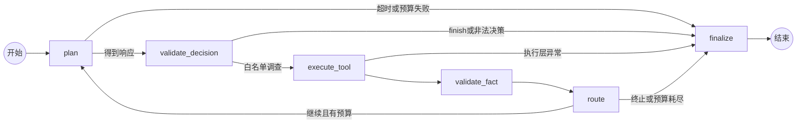

# Discovery Agent：LangGraph 离线对照运行器

本轮是编排试验，不切换 V1 默认入口。`run_agent`、旧 `run_insights` 及确定性发现内核保持原样。
开工 main 为 `761d209`；#49 OPEN，固定其安全修复提交
`91de608a30409f92809e63d7a820b189cedcb1fd` 建立独立 worktree。
PR 堆叠在 #49 分支，审核时只比较新增编排；不能在 #49 合并前当作独立 main 功能发布。
#47 OPEN，参考其 `91463121` 契约但不改标准答案；#53 是独立导入投影 Draft，不构成本轮依赖。
自适应测评、Canonical Assessment Model、新资料解析器和正式教师接入均未改动。

## 运行与真实记录

仓库根目录，Python 3.12：

```powershell
uv sync --project apps/api --locked --group dev
uv run --project apps/api --locked python scripts/edu_langgraph_demo.py
# 保存到新的文件；拒绝覆盖已有归档
uv run --project apps/api --locked python scripts/edu_langgraph_demo.py --output D:\Temp\langgraph-new-run.json
uv run --directory apps/api --locked pytest tests/ai_edu/test_langgraph_runtime.py -q
uv run --directory apps/api --locked pytest tests/ai_edu tests/discovery -q
uv run --directory apps/api --locked pytest -q -ra
```

独立入口（显式导入，不从旧包入口自动加载 SDK）：

```python
from app.ai.edu.discovery import AdaptiveFake
from app.ai.edu.discovery.langgraph_runtime import run_agent_langgraph

result = await run_agent_langgraph("coupled53", AdaptiveFake())
```

`evals/discovery_langgraph/offline-trace.json` 是脚本实际执行的四组对照
（53/17 人 × Fake/原生 HTTP Mock），另有两个失败探针。
包含原始运行 ID、实际耗时、聚合事实、原始选择/最终展示、独立事件 Trace、工具账本、
来源绑定摘要及 SDK 实际生成的 Mermaid。没有学生评分行、内部来源对象、凭据或 Token/费用估算。
Mock 请求确实经过原 `MockQwenPlanner`/httpx sender；不是真实 Qwen 质量评测。

已核验：53 人目标26/余组27，均值5和1、差4，一张合格卡；17人同分返回零发现。
专项另以相同合成构造器向两运行器注入 20 人去重反例：先调查的差 -0.2 不合格，
反向分析另一结果维度的差 -4、10/10 必须保留；再反转同一分区则拒绝重复。
这些构造器只在测试中注入，不新增接收任意学生资料的运行入口。

## 六节点与条件边

`langgraph_runtime.py` 实际创建 `StateGraph(GraphState, context_schema=RunContext)`。
没有将旧 while 包成单个节点，也没有在图节点里调用旧 `run_agent`。



| 节点 | 实际工作 |
| --- | --- |
| plan | 只用已发布的聚合事实生成原白名单 prompt，申请一次共享预算后请求决策器 |
| validate_decision | 严格 JSON/Pydantic 校验、工具/事实 ID/参数/能力准入；失败尝试仍计数 |
| execute_tool | 原 `ToolExecutor.execute` 在本轮暂存发布容器上计算；不立即发布事实 |
| validate_fact | 复用资格/来源检查，复核事实归属、实际逐指标来源、模型正向投影、累计披露和输出预算，然后一次提交 |
| route | 根据实际结果、固定终止错误和剩余请求预算走条件边 |
| finalize | 仅从已提交事实调用原 `finish`，保留未通过的提议 ID，不用模型文字造卡 |

LangGraph 替代新入口里的循环调度、分支连接、跨步骤状态传递及结束路由。
安全语义仍由原工具和本次运行账本保证，不交给模型或 SDK 的默认重试行为。

## 一次运行的预算、幂等与原子性

`RunSession` 通过 `context_schema` 传递；`GraphState` 只有 `turn`、`destination`。
原始合成数据、内部来源、执行器、原始模型响应不进入图状态通道。
私有上下文也不能外传；它不因不在 state 中就自动成为可公开对象。

- 每 run 最多6次模型请求、5次工具尝试；无效参数、隐私拒绝等失败不退款，finish消耗模型请求。
- 每节点以 `(node, turn)` 记录完成结果，plan 的并发重入共用锁；阶段/轮次守卫拒绝越序提交。
  同一上下文重建图、重放节点或重建 HTTP Client 均不能刷新额度或重复计算/发布。
- 工具复用原数据和执行器逻辑，仅复制 facts/released/discoveries 等发布容器；
  已发布聚合 view 深复制，避免失败的暂存工作污染历史事实。来源及计算规则保持原对象。
- 只有 validate_fact 成功后才提交新的执行器状态。失败保留既有事实、已发布集合和字节额度，
  但记录已消耗尝试、去重键和真实计算时间。检查返回事实与暂存字典一致，不能偷换未核验对象。
- k≥5，同一次工具内累计集合差分抑制继续复用原 `_gate`；不是重新实现披露算法。
- 图禁用节点重试/缓存；64 super-steps 只是保险，不是预算来源。总运行时间仍按原轮次边界检查，
  同步计算不宣称可抢占。SDK 包装的 NodeCancelledError 恢复为原 asyncio.CancelledError。

这是同一进程、同一运行内的防重；不是持久化恢复或跨进程 exactly-once 承诺。
未配置 checkpointer/store，未实现 interrupt/resume。未来启用它们必须重新验证副作用重执行，
不能把本次内存 memo 当作恢复协议或把学生资料写入 checkpoint。

## 云追踪与能力注册边界

入口使用 `tracing_context(enabled=False)`、空 callbacks，并在当前异步上下文临时清除/恢复
LangChain 的 active tracer ContextVar；测试覆盖环境开关及调用方已启用 tracer。
不会全局修改调用者设置，不接 LangSmith 云服务。该钩子随锁定的 langchain-core 版本验收，
升级 SDK/相关包时必须重新运行云追踪和取消测试。
Production、Synthetic Live 及非 offline 决策器仍在建图前拒绝；不读取 Qwen Key。

`CapabilityRegistry.authorize(tool, typed_arguments)` 是可信的能力选择接口。
默认 `RegisteredCapabilities` 仅放行现有严格注册工具，也可按当前可用工具/维度缩小集合。
未来审核过的 AssessmentItem/量表适配器可提供该注册表，图本身不枚举五维或实现分析公式。
当前仍使用 #49 的 V1 Pydantic schema 和 ToolExecutor；不能靠注册表放行未知工具、任意参数、
新维度或新量表。通用测评适配由另一任务实现，本轮不声称已支持不同结构的实际导入。

## 对照口径与成本

比较保留合格发现、数值、资格、完整逐指标来源绑定、工具参数/顺序、错误、预算及原始选择。
只归一化随机 run_id 及其引用、真实耗时；图特有 graph_node 事件单独保留，
语义 Trace 去掉这类事件后重新编号再比较。内部测试直接比较 Discovery/SourceSet，
归档使用完整来源摘要，不能仅凭人数或同批归属判定来源一致。
#47 冻结标准答案及历史 A/B 结果未改；本轮不是完整19例 C_agent、模型质量或增量覆盖率报告。

依赖明确锁定 LangGraph 1.2.17、langchain-core 1.7.0、langsmith 0.14.12。
原有锁定包版本不变，lock 新增27项（含平台项）；后两项是云追踪隔离代码的直接依赖。
SDK 本身带来 checkpoint、prebuilt、SDK、LangSmith、序列化/HTTP 等依赖，安装不等于启用。
其中 httpx2 会被当前 Starlette TestClient 优先采用，因此必须做全量后端回归；
原应用使用的 httpx 0.28.1 未升级。

新增分节点账本、暂存核验和 SDK 依赖，代码与维护复杂度高于原紧凑循环；收益是明确的
可测试节点/路由、能力准入边界及后续工作流扩展位置，不是本轮证明的性能提升。
归档保留 wall/tool/non-tool 实测时间；non-tool 包含规划、框架与校验成本，不能全称为框架耗时。
这些都是本机机制测量，不是 SLA。**旧 run_agent 继续为默认入口，是否推广由后续审核决定。**

参考官方当前稳定发布与 API（2026-10-26核对）：
[PyPI 1.2.17](https://pypi.org/project/langgraph/1.2.17/)、
[StateGraph/conditional edges/context_schema](https://docs.langchain.com/oss/python/langgraph/graph-api)。
