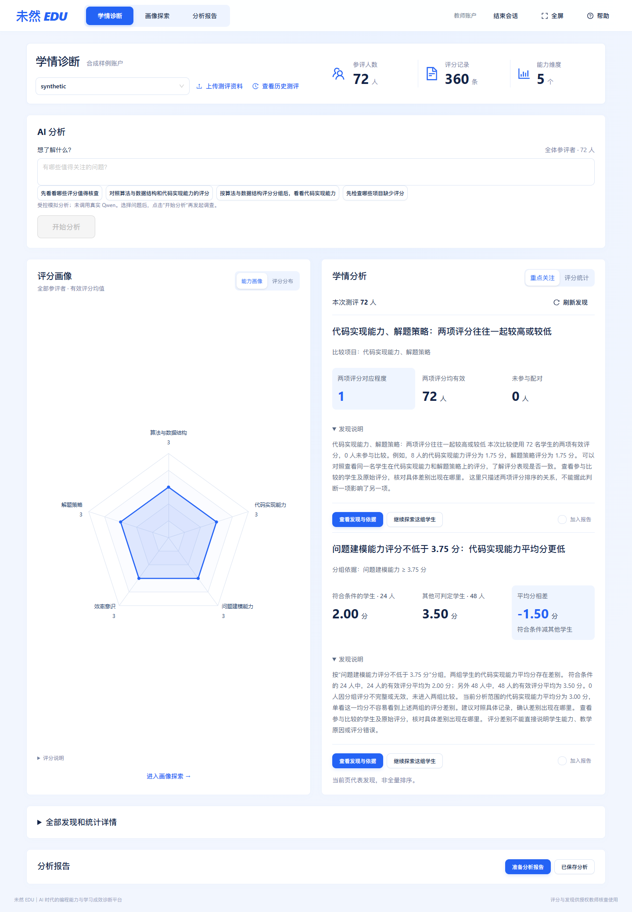
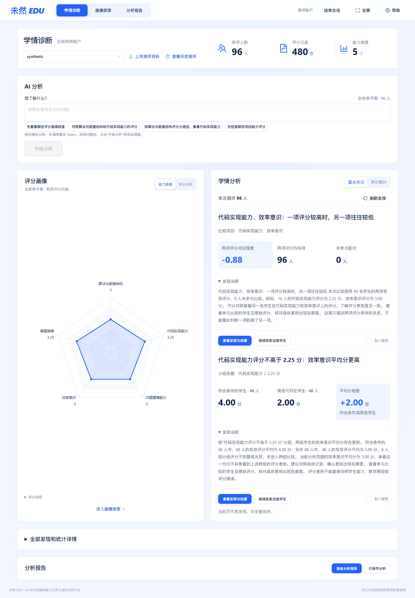
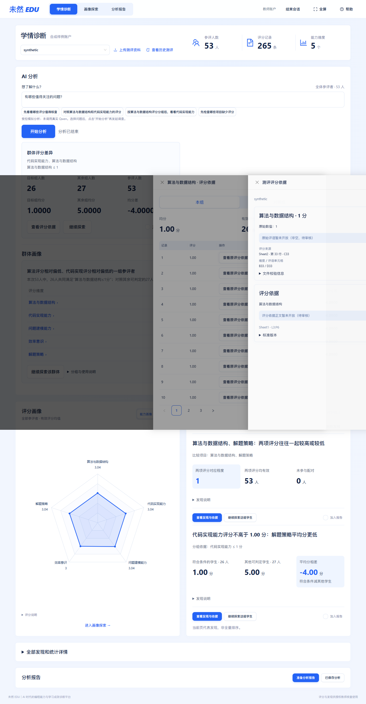
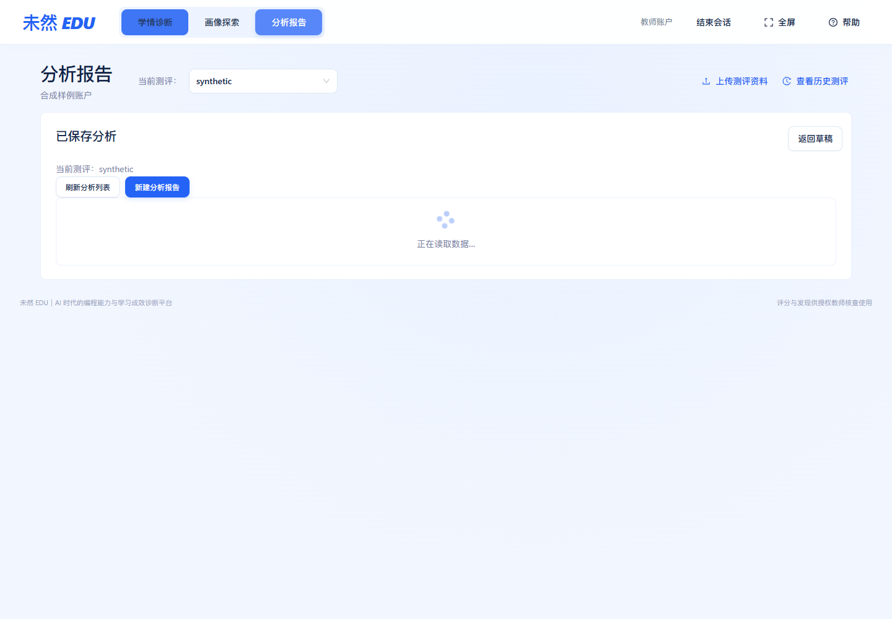

# PR #93：两处 504 的宿主对照与最小修复

## 范围与结论

固定比较发布基线 `15788491b536d408005030ddbed2cee2d1a9f6b2`、#91 `da7c27920f3c40cf53e57efafa805c73894a3e84`、#93 `13cdc04184f5d96e13bddcd31ba2b5da83a8be8e`。本分支以准确 #93 为父提交，只修验收宿主，不修改产品执行逻辑，不覆盖三个源提交。

已经捕获的停顿发生在 Windows 测试宿主的 `multiprocessing.Process.start()` 阶段。API 线程停在 `popen_spawn_win32.py → reduction.dump(process_obj, to_child) → ForkingPickler.dump`，主线程停在 `sys.stdin.readline()`。父进程尚未进入接收结果的线程，子进程尚未进入发现算法。释放主线程的标准输入后，start 才返回。用相同代码/数据，把停止控制改为轮询私有 stop.flag 后，子进程能够启动、计算并回传。

这不是“发现算法花了 40 秒”的证据，也不是未知问题被当作合法问题运行。未知问题在发现开始前直连/中继均返回 422 `AI_GOAL_UNSUPPORTED`；旧宿主启动发现后，API 事件循环停顿，普通 `/me` 与未知 AI 请求一起失去响应，Next 保持原 40 秒上限并正确返回 504 `REQUEST_TIMEOUT`。直连测量到达客户端截止时间时没有 HTTP 响应，记录为 timeout/null，绝不写成后端 504。

发现输入读取前后的 SQLite 事务都已关闭，未见阻塞事务；输入装载后进入同步 start 的位置和心跳停顿一致。未改变 SQLite、算法、权限、来源核验、Fact/Witness、缓存键、Agent 预算或全局超时。

## 最小修复

- `apps/web/tests/integration-synthetic-host.py`：主线程用私有 TemporaryDirectory 下的停止文件控制退出，保持标准输入空闲。Uvicorn 原有线程和应用装配保持不变。
- `apps/web/tests/analysis-perf-integration.mjs`：协调者记录宿主私有目录，清理时写入停止文件。只结束自己启动的进程。
- 其余新增文件为定位/复现脚本及验收记录，不是产品修复。

## 对照方法

Windows（内核 10.0.26100）、Python 3.12.10、20 逻辑 CPU；锁定 Python 环境与相同 pnpm 锁文件。三个不可变 worktree 分别使用已有生产 Next 构建，真实 FastAPI、临时 SQLite、原生 Windows spawn。四种合成 XLSX 只生成一次，所有对照使用相同字节，并记录 SHA256。无真实教师资料、付费模型或静态成功响应。

每个单元重新创建宿主/数据库，先分别直连和中继发送未知问题，再发首次发现查询；并发单元在发现开始 500ms 后发送未知问题（直连/中继）和普通 `/me`。首次发现均使用新诊断 nonce，避免复用命中掩盖冷启动。前后唯一实验变量为停止控制：`stdin_thread` 与 `poll_thread`。105 人仅作为诊断对照：既有合成 AI 授权上限仍为 100，105 的 AI 请求保持 403，不扩大预算/授权范围。

首次发现直连观测上限 45 秒、中继外部观测上限 50 秒；并发直连上限 55 秒。它们只是测试客户端的观测窗口，不改变产品 40 秒中继或后端 60 秒发现预算。旧宿主卡在同步 start，原异步取消/预算循环尚未获得执行机会；客户端退出后的后端 499 不能冒充请求已成功响应。

实际请求、回归与限制分别列于下文。

## 历史失败的含义

#93 首轮 pytest 的两项失败不是同一种失败，不能直接归到本次 stdin 宿主：

1. `test_persist_reload_evidence_review_and_report`：review-submissions 期望 200，实际 503 `DISCOVERY_TIMEOUT`，属于正式重新计算阶段。
2. `test_teacher_priority_alias_rejects_unsafe_text_and_reuses_controlled_task`：导入 commit 期望 201，实际 503 `IMPORT_PROCESSING_UNAVAILABLE`，尚未创建 AI 调查。

此前报告中的 120 秒是 Playwright 等待重点卡片/预期响应的上限；实际 HTTP 请求约 40 秒已返回 504。它不是一次耗时 120 秒而成功的后端调用。历史两项隔离重测 2 passed / 82.39 秒只说明当次通过，不能抹去首轮失败。本次将分别记录无额外负载与明确的两个 CPU 计算进程负载下的重复结果。

## 已完成的严格对照

[逐请求状态、耗时、执行阶段、数据 SHA256 与启动失败记录](validation/pr93-504/controlled-requests.json)。共 18 个前后匹配单元；每个版本各测 72/53 人直连及中继并发场景、105 人直连及中继单独场景。修复后每个有效冷请求均记录一次 worker 执行，未用计算复用代替首次计算。

停止控制修复前，三个版本的 72/53/105 人直连首次查询均在客户端 45 秒截止时仍无 HTTP 响应；经过 Next 均约 40 秒返回 504。A/B/C 均在 process.start 写入阶段停住。修复后如下，单位秒，所有发现请求为 HTTP 200：

| 版本     | 72 人直连 / 中继 | 53 人直连 / 中继 | 105 人直连 / 中继 | 三类发现保留数 |
| -------- | ---------------: | ---------------: | ----------------: | -------------- |
| A 原基线 |    3.654 / 3.693 |    3.217 / 3.270 |     4.954 / 4.534 | 32 / 26 / 15   |
| B #91    |    3.851 / 3.851 |    3.209 / 3.411 |     5.023 / 5.002 | 32 / 26 / 15   |
| C #93    |    4.271 / 4.342 |    3.341 / 3.272 |     4.868 / 4.446 | 32 / 26 / 15   |

#93 的 53 人未知问题：单独直连 210–233ms、中继 288–309ms；与发现并发时直连 846–903ms、中继 875–880ms，全部 422 `AI_GOAL_UNSUPPORTED`。修复前的单独问题也返回 422；只有发现启动后被整个事件循环阻塞，才出现中继 504/直连客户端超时。并发普通 API 修复后全部 200。

#93 的阶段记录：Windows start 0.935–1.074 秒，子进程内工作模块导入 1.310–1.658 秒，实际发现计算 0.239–0.535 秒，结果发送 7–52ms，父进程收到结果后完成清理/返回 worker 为 29–64ms。相关请求在 spawn 前未关闭事务数为 **0**。未见计算或退出卡住；启动仍有约一秒同步成本，本轮未重构它。

[捕获的阻塞堆栈](validation/pr93-504/blocked-stack.txt) 与 [不导入 EDU 的标准库复现](validation/pr93-504/stdlib-reproduction.json) 是独立证据。后者三次保持 stdin 读阻塞直到协调者在 3 秒时释放，start 分别 2850/2848/2848ms；三次保持 stdin 空闲则为 403/422/401ms，六次均正常退出。本结论限定于本机 Windows/Python 及管道 stdin 控制方式，不冒称已经定位所有 Windows 内核内部细节。

三次额外宿主启动失败也保留在 JSON 中：#91 的一个 Next 就绪检查失败，两个宿主未就绪，均未进入业务请求。未提高就绪或请求超时，随后原条件重测三项均完成。另一次 A-53 单元发生测量结束后的清理进程退出竞态，七条真实请求和完整阶段日志已恢复，标记 `cleanupRecovered`；未重写原始请求结果。隔离应用进程不等于隔离整机全部负载，不能把这些启动异常当作产品 HTTP 成功。

## 复现方式

在本修复分支 `apps/web` 下，用锁定环境和三个准确 SHA 的独立 worktree：

```powershell
$env:EDU_TEST_PYTHON = '<locked Python 3.12 Scripts/python.exe>'
$env:EDU_TRACE_ROOT_A = '<15788491 worktree>'
$env:EDU_TRACE_ROOT_B = '<da7c2792 worktree>'
$env:EDU_TRACE_ROOT_C = '<13cdc041 worktree>'
$env:EDU_TRACE_ROOTS = 'A,B,C'
$env:EDU_TRACE_CASES = '72:direct:concurrent,72:relay:concurrent,53:direct:concurrent,53:relay:concurrent,105:direct:single,105:relay:single'
$env:EDU_TRACE_HOST_MODE = 'stdin_thread'
$env:EDU_TRACE_ROUND = 'before-new'
node tests/blocker-control.mjs
# 将上一步输出的 dataDirectory 原样传入，确保字节相同。
$env:EDU_TRACE_DATA = '<dataDirectory>'
$env:EDU_TRACE_HOST_MODE = 'poll_thread'
$env:EDU_TRACE_ROUND = 'after-new'
node tests/blocker-control.mjs
node tests/stdin-spawn-repro.mjs
# 自有 worktree 完成生产构建后：
node tests/analysis-perf-integration.mjs
node tests/diagnosis-return-reuse.mjs
```

三个对照 worktree 的 Next 均须先生产构建，构建前核对 git SHA 与相同锁文件。比较工具也会检查准确 HEAD。诊断脚本的所有追踪封装只存在于测试进程；实际算法、权限和来源验证仍来自被测 worktree。临时工作簿、数据库和私有连接凭据均不提交。

## 生产浏览器回归

[完整浏览器 HTTP 记录与断言结果](validation/pr93-504/browser-results.json)，使用本 worktree 的新生产构建、真实 Uvicorn/FastAPI、临时 SQLite 和 Chromium。产品代码与准确 #93 完全相同。

| 项目                           | 实际结果                                                                                         |
| ------------------------------ | ------------------------------------------------------------------------------------------------ |
| 72 人重点发现                  | PASS；首次查询 200 / 3.902 秒，返回查询 200 / 0.671 秒；两个有区分度的代表标题及完整说明可见     |
| 96 人重点发现                  | PASS；首次查询 200 / 4.054 秒，分析与 72 人数据不同                                              |
| 静态发现、图表、学生与原始依据 | PASS；SVG、真实记录查询、原评分证据显示，未复用敏感依据授权                                      |
| 53 人发现与未知问题            | PASS；发现 200 / 3.407 秒，未知问题 422 `AI_GOAL_UNSUPPORTED` / 159ms，显示友好指引且保留原问题  |
| 合法快捷提问                   | PASS；点击快捷按钮只填入问题，明确点击开始后 POST 202 / 489ms；轮询/复核 GET 200，最终 completed |
| AI 画像及评分依据              | PASS；实际返回 2 个 Fact、1 个画像，画像评分查询 200 / 2.448 秒，可打开原评分依据                |
| 报告入口                       | PASS；实际导航并显示报告页，浏览器没有调用 review-submissions 或创建正式报告                     |
| 模型来源                       | PASS；标明受控模拟、真实 Qwen not_run；无真实模型请求                                            |
| 未处理页面异常                 | 未捕获；两个浏览器脚本 errors 数组均为空                                                         |
| 390px                          | FAIL（已知展示问题）；存在横向溢出，未在本轮改版式                                               |

终态 `stop_reason=investigated_candidates_complete`；task ID 可在真实网络路径中追溯为 `cde0c662-06db-494f-a48a-5081ce7bc32d`，不是人为写入的成功结果。没有把未知问题转为受支持问题。

首次浏览器运行曾在合法 72 人页面上触发错误断言：[原始断言记录](validation/pr93-504/browser-assertion-first-attempt.json)。旧断言要求每段解释逐字包含班级总人数 72，但实际合法解释是 24 人与另外 48 人。仅修改测试，分别核对服务端实际配对/分组人数、详情 scope、文字长度和核查提示；增加画像评分及原依据的实际点击回归。没有更改产品文字、评分、发现资格或排序。修正后完整流程重新运行通过。

两种已实际显示的数据说明也验证 #90 没有退回通用均分模板：

- 72 人：问题建模评分不低于 3.75 分的 24 人，代码实现有效均分 2.00；其余 48 人为 3.50。全范围代码实现均分 3.00，单看整体不能看到分组差别。
- 96 人：代码实现评分不高于 2.25 分的 48 人，效率意识有效均分 4.00；其余 48 人为 2.00。全范围效率均分同样为 3.00，显示的分组条件、人数和评分项目均来自各自实际结果。它们不说明学生能力或教学因果。






## 105 人性能与隔离

[本轮逐请求、worker 次数和隔离结果](validation/pr93-504/performance-isolation.json)。相同测试脚本、独立标准应用宿主，AI 不启用；该宿主原本就没有主线程 stdin 等待。

| 页面完成时间（秒） | #93 交付时记录 | 本轮原产品代码 | 本轮真实计算次数 |
| ------------------ | -------------: | -------------: | ---------------: |
| 首次               |         10.424 |         10.566 |                1 |
| 返回 1             |          5.097 |          6.738 |                0 |
| 返回 2             |          5.110 |          5.097 |                0 |
| 返回 3             |          5.079 |          5.537 |                0 |

各项均 3 个发现请求、全部 200；没有恢复重复计算。首次相差 0.142 秒；返回耗时有波动，其中一次较历史记录慢 1.641 秒，保留该差异，不宣称即时返回或所有环境均无性能变化。历史与本轮不是同时测量，不能据此给出严格统计性能保证。

本轮隔离断言全部通过：批次切换独立计算；同一教师结束会话再连接更换计算会话；教师 B 不显示 A 的批次；撤销 B 成员权限后发现 404 / 90ms 且旧卡片为零；撤销令牌后 401 / 62ms 并清会话；真实导入修订产生新批次/快照，错配快照 409 / 25ms，合法授权历史快照仍可读，新快照重新计算。原图表、学生和证据 API 全部保留原实时授权。

脚本还记录 16 条页面离开导致的 `net::ERR_ABORTED` 取消请求，包含修订时离开的旧发现请求。这些没有 HTTP 成功状态，不计作 200。新快照步骤记录 2 次 worker 尝试，包含离开旧批次后取消的一次；不把它伪称为始终只有一次计算。

## 静态检查与后端边界

- 前端 18 文件 / 254 单测通过；ESLint、Next typegen、TypeScript 通过。
- 本 worktree 的 `next build --webpack` 通过（使用锁定依赖；Webpack 支持既有 node_modules junction），生产 smoke 通过，未使用开发服务器代替生产。
- 后端 `ruff check .` 与 `ruff format --check .` 通过，232 文件；新增 Python 宿主/复现工具 Ruff 和格式检查通过。
- 标准 Prettier 仍因原有 138 文件 CRLF/LF 问题失败；`--end-of-line auto` 全部通过。未批量修改其他文件，不宣称所有门禁全绿。

后端 76 项定向整组测试 **INCONCLUSIVE**。两次 PowerShell 直接执行未得到完整摘要/JUnit（一次空输出，一次只有两个通过标记）；改为明确 stdin=ignore、收集原生错误的 Node 协调执行后，146.977 秒退出码 1，输出 14 个通过标记，没有失败摘要或 JUnit。即使启用 PYTHONFAULTHANDLER 也未收到可定位的原生栈。没有证据把它归到某个业务断言，更不能写成“76 passed”或认定与本次 stdin 504 为同一原因。本轮没有据此修改产品或扩充预算。

[本次 pytest 结果与异常退出证据](validation/pr93-504/pytest-results.json)。无额外负载的独立两项复测为 **2 passed / 1 既有 warning，73.62 秒**（含启动 76.572 秒）。三轮受控负载中，两个历史失败用例每轮也都实际通过：

| 轮次 | 额外负载              | pytest 实际摘要               | pytest 秒数 | 含启动的协调耗时秒 |
| ---- | --------------------- | ----------------------------- | ----------: | -----------------: |
| 1    | 两个独立 CPU 数学循环 | 2 passed / 1 既有弃用 warning |       76.92 |             79.982 |
| 2    | 同上                  | 2 passed / 1 既有弃用 warning |       70.96 |             73.954 |
| 3    | 同上                  | 2 passed / 1 既有弃用 warning |       70.22 |             73.181 |

每个负载进程最多运行 240 秒；三轮测试结束时两个负载进程均仍在运行，之后只终止本轮拥有的两个进程。它们不使用数据库、不请求模型。20 逻辑 CPU 上的两个计算进程不代表所有极端 CPU、磁盘、内存压力场景；因此结论是**未能在该明确负载条件下稳定复现原两项超时**，不是宣布它们从此不会失败。

复现命令（apps/web；使用锁定 Python 和同版本基础解释器）：

```powershell
$env:EDU_LOAD_PYTHON = '<base Python 3.12/python.exe>'
$env:PYTHONFAULTHANDLER = '1'
# 完整 76 项无额外负载 + 历史两项在两个 CPU 进程负载下三轮
$env:EDU_PYTEST_FULL = '1'
node tests/blocker-pytest-controls.mjs
# 脚本保留每轮真实退出码；整组异常退出不会被后面的通过覆盖。
```

### 集成建议与剩余风险

本轮两处 HTTP 504 的实验根因已确认，最小修复仅针对测试宿主，真实页面和请求已恢复。**暂不建议将 #93 当作已通过完整门禁的集成成果推进；保持 Draft，先独立审核宿主补丁并查清 76 项整组测试异常退出。** 390px 横向溢出、标准格式失败和返回耗时波动也按实际保留，不在本轮重构/改版。

当前演示启动脚本原有未提交改动未触碰，前后 SHA256 均为 `E32F11F8DDFB0A398AA71B2532A3EDA354B643E5B476220AA6E6113AAE610BE1`。未停止或启动正式演示，未合并 release/main，未推送或覆盖 #90/#91/#93，未启用真实 Qwen。产品源代码、原型、权限、预算、接口、数据库结构及两端锁文件与准确 #93 保持相同。宿主问题不被包装成新的产品修复。

无额外负载的两项单独复测命令（避免覆盖整组失败证据）：

```powershell
Remove-Item Env:\EDU_PYTEST_FULL -ErrorAction SilentlyContinue
$env:EDU_PYTEST_ROUND = 'pytest-normal-two'
$env:EDU_PYTEST_LOADS = '0'
node tests/blocker-pytest-controls.mjs
```

本分支改动文件限于：两个既有浏览器/合成宿主测试文件，五个新增对照/标准库/pytest 协调工具，本报告与合成验证证据。独立人工审核未完成，没有把自己的执行记录当作独立批准。准确本地提交 SHA 以交付回复和 `git rev-parse HEAD` 为准；原 #93 提交保持不变。
