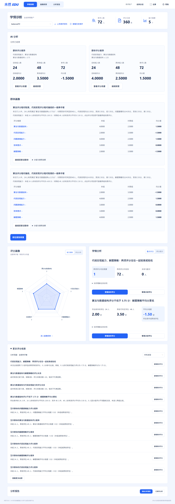
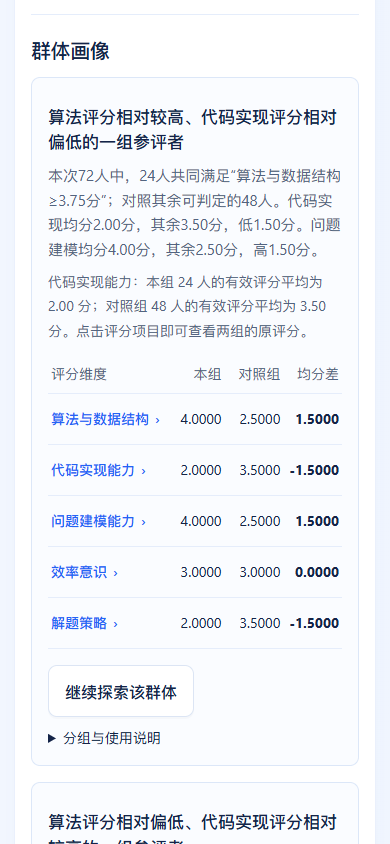
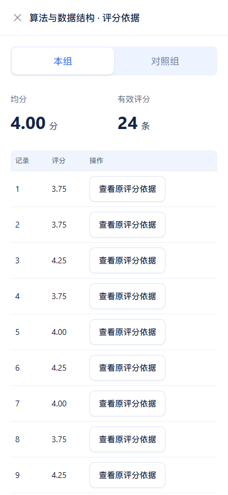
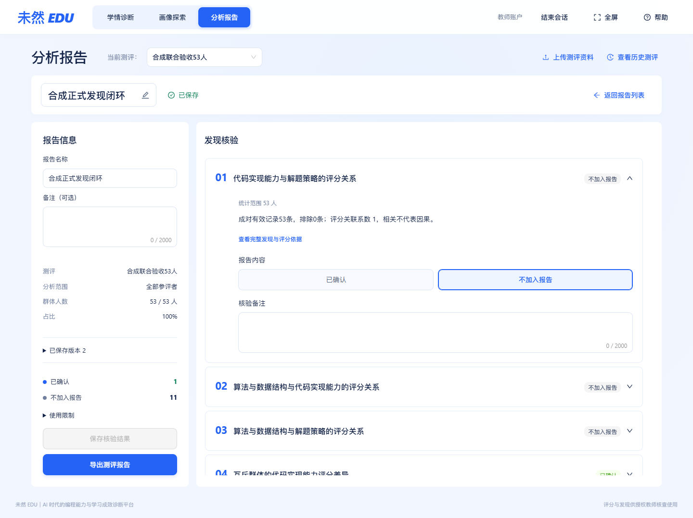
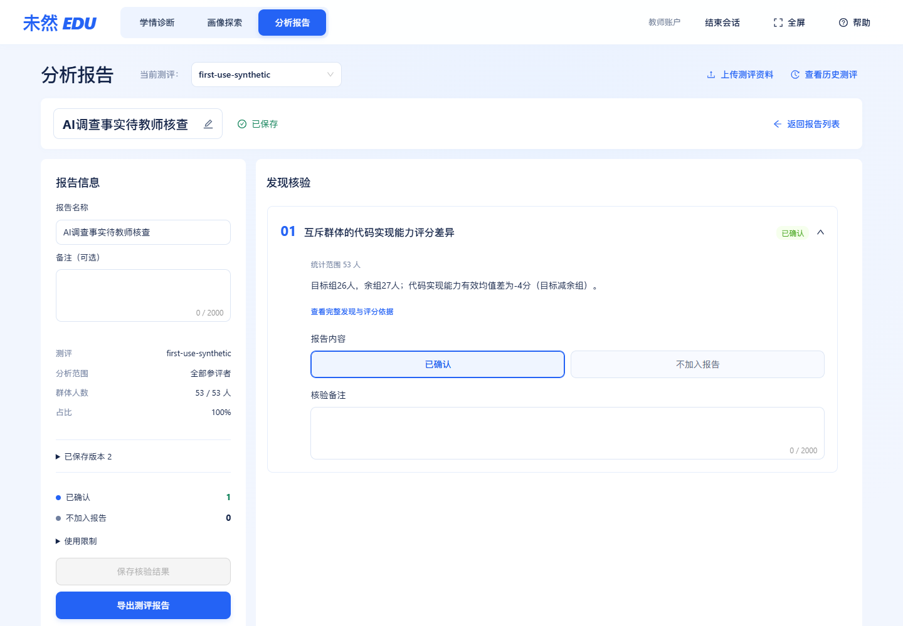

# V1.3 负责人体验候选验收记录

范围：隔离集成分支，Windows 本机、临时 SQLite、真实 FastAPI、Next.js 生产构建及 Chromium Edge。网页 Agent 使用 HTTP Mock 规划回复，所有统计、Fact/Witness、画像和评分来源仍由程序核验。未调用真实模型，未接正式教师账户，未修改 release/main。

## 固定来源及整合

| 来源 | 固定 SHA |
| --- | --- |
| 发布基线（已含 #94 报告结论） | `0b65bcf4139545fec5dd04f0d087c8e1132c03ec` |
| #92 前端、报告 | `08b6f8c1c955b0f1ce2c32980d3e7e404892ed40` |
| #93 诊断复用、解释 | `13cdc04184f5d96e13bddcd31ba2b5da83a8be8e` |
| #96 任务结果回读性能 | `3eeb3b6d0f8b4bdb1a172bc3486f0a3ab8dea2c8` |
| Windows 宿主修复（包含 #93 祖先） | `d96303ab86bc17d355c21a979d197d9103d0d7bc` |

以上提交均作为祖先纳入，没有覆盖任何原分支。开工时 #92/#93/#96 仍为 Draft/Open，正式 review 列表为空；本次体验集成不代表这些 PR 已获合并批准。前端冲突以 #92 为主，恢复 #93 的会话隔离诊断复用和已有的合成来源拒绝提示；没有叠加第二套页面。

额外产品补丁仅涉及本机启动安全和样例可辨识性：启动器不再全局扫描/结束服务，按本次进程 PID 与启动时间停止；端口占用直接拒绝；合成宿主用样例名作为上传文件名，避免六个批次全部显示为 `synthetic`。没有改变文件内容、评分或证明。

## 报告数量结论

`exports.py` 原逻辑正确：计数是已保存的普通发现 `findings` 与正式发现 `discovery_findings` 中所有 `confirmed` 项。`receipt.candidate_ids` 表示 AI Fact 提交后映射的候选引用，不能直接作为确认数量。

旧验收器只按正式发现数量检查，且只识别 Markdown 表格里的计数；#94 已将该计数放在正文段落。因此修正验收器及对应 E2E：直接读取保存结果的两类状态，排除 pending/dismissed，检查重复身份，兼容正文/表格并拒绝互相矛盾的重复元数据。MD/XLSX 的批次、快照、保存引用、版本、评分和来源引用继续校验。没有修改导出业务计数。

## 已执行的检查

环境：Python 3.12.10、Node 24.15.0、pnpm 11.25.0、锁定依赖、`PYTHONUTF8=1`。新的独立工作区完成依赖安装及生产构建；不是在一台未安装任何工具的全新 Windows 虚拟机上测试。

| 检查 | 实际结果 |
| --- | --- |
| 前端 Vitest | 18 文件、255 项通过 |
| 报告验收器 `node --test tests/report-artifact-utils.test.mjs` | 2 项通过，含混合状态、零确认、错误计数、重复身份和元数据矛盾反例 |
| 前端 lint、typecheck、build | 通过 |
| `pnpm format:check` | 通过；仅在本工作区把 CRLF 按既有 Prettier 标准转换为 LF，Git 内容没有产生批量差异 |
| `node tests/smoke.mjs` | 生产页面、路由、合成模板下载、404 通过 |
| 后端报告、导出限制、诊断复用、任务及状态回读 | 132 项通过、1 条既有 Starlette 弃用警告，370.95 秒 |
| 画像、验证复用、首次上传授权 | 30 项通过、1 条同类弃用警告，326.78 秒 |
| Ruff / Python format | 所涉及后端目录及宿主文件通过 |

后端命令（在 `apps/api`，设置仓库根目录和 `apps/api` 的 `PYTHONPATH`）：

```powershell
python -m pytest -q tests/reporting tests/edu/test_discovery_report_limits.py tests/edu/test_discovery_reuse.py tests/durable_teacher_agent/test_status_latency.py tests/durable_teacher_agent/test_tasks.py
python -m pytest -q -ra tests/durable_teacher_agent/test_database_profiles.py tests/durable_teacher_agent/test_validation_performance.py tests/durable_teacher_agent/test_first_use.py
```

30 项安全回归包括：五维与数据库评分独立对账、Witness、来源修改、画像均值/规则篡改、删除 profile_projection 并重算哈希的 P1 反例、预算不重置、k=25 累计披露和禁止分页恢复隐藏分布、撤权、重启、旧任务、13 题不冒充五维。

## 浏览器证据及复现

`acceptance.json` 保存去凭据的实际结果。浏览器主业务检查分别覆盖：

- 53 人上传、预览、质量确认、入库、重点发现、26/27 群体、图表、探索、刷新和原评分。
- 教师确认、保存、实际冲突 409 保留编辑、MD/XLSX 下载并重新打开、历史归档/恢复、390px。
- 17 人同分零合格发现、合法空报告、只读 403、撤权 404、过期凭证 401。
- 105 人、525 条评分的小数/精确分数传输、来源、保存及导出，陈旧快照 409。
- AI 真实任务创建/轮询、合格 Fact、原评分、探索、报告核查、确认、保存和真实文件下载；不支持问题 422 不创建任务；跨批次与陈旧快照 409。
- 72 人两张画像、五维、点击才加载本组/对照组明细、原始评分、390px、任务刷新恢复、来源撤权后拒绝。
- 真实 Windows 启动器的空账户：上传本次登记的 XLSX，沿同一批次完成 AI、原评分、探索、刷新恢复、教师核验、保存、MD/XLSX 下载重开；`api_failures=[]`、`page_errors=[]`，不是把不同账户的结果拼接成上传成功。

两种启动身份分别返回 0/6 个批次；重复使用其已占用端口会拒绝启动，原会话 `/me` 仍为 200；显式停止仅结束自己记录的进程。已执行空账户、样例账户和再次空账户启动。首次样例登记约 80—90 秒，后端没有为此提高任务或 Worker 超时。

前两组使用 `tests/discovery-api-flow.mjs` 的 `EDU_PRODUCT_FLOW=1` / `EDU_INTEGER_FLOW=1`；AI 组使用 `tests/owner-experience-e2e.mjs`。设置 `EDU_OWNER_STAGE=ai` 可仅复跑 AI 组，报告会明确标明覆盖范围；不能把仅 AI 的单次结果当成整轮执行。

```powershell
# 在 apps/web；先完成锁定安装及 build
$env:EDU_TEST_PYTHON = (Resolve-Path ../api/.venv/Scripts/python.exe).Path
$env:EDU_TEST_BROWSER = 'C:/Program Files (x86)/Microsoft/Edge/Application/msedge.exe'
$env:EDU_TEST_BACKEND_REVISION = (git rev-parse HEAD).Trim()
$env:EDU_TEST_FRONTEND_REVISION = $env:EDU_TEST_BACKEND_REVISION
$env:PYTHONUTF8 = '1'
Remove-Item Env:EDU_OWNER_STAGE -ErrorAction SilentlyContinue
node tests/owner-experience-e2e.mjs
```

浏览器必须选择实际存在的 Chromium 可执行文件。本轮前期失败包括旧报告计数/段落断言、多卡片定位、缺失的测试宿主描述、错误的 Chrome 路径，以及新增首次上传脚本未等待导出预检。对应测试已修正；没有放宽业务校验或把失败改为 skipped。最终结果以 `acceptance.json` 各组记录为准。

首次上传的连续脚本为 `tests/first-use-owner-e2e.mjs`。在自己启动的 `-Identity first` 会话上设置 `EDU_OWNER_ORIGIN`、启动器打印的 `EDU_OWNER_SAMPLE_FILE`、`EDU_TEST_PYTHON` 和 `EDU_TEST_BROWSER` 后，从 `apps/web` 执行 `node tests/first-use-owner-e2e.mjs`。该脚本不管理其他服务，不携带浏览器 Authorization，不调用远程模型。







## 限制

完整后端 pytest、新 SHA 的 GitHub CI、8 客户端满速压测和真实 Qwen 均未在本轮执行。工作流只自动响应 main push/main PR，本分支推送不等于 CI 通过。已有高并发 503/超时风险保留；本机普通体验不能证明所有负载条件稳定。

较早一轮辅助验收曾记录一个后台发现详情 503，未单独确认其根因；最终相同业务脚本复跑没有 5xx（16 个成功的发现请求），只记录撤权/过期凭证的 404/401。独立的首次上传到 AI 报告链路没有任何 API 失败。本次不宣称已经根除所有偶发 503。

任意文件不能自动获得 AI 或远程外发授权，逐题导入及真实教师登录不属于这次体验承诺。所有截图使用合成内容，没有提交生成的含学生行 Excel、数据库、私有连接文件或凭据。
